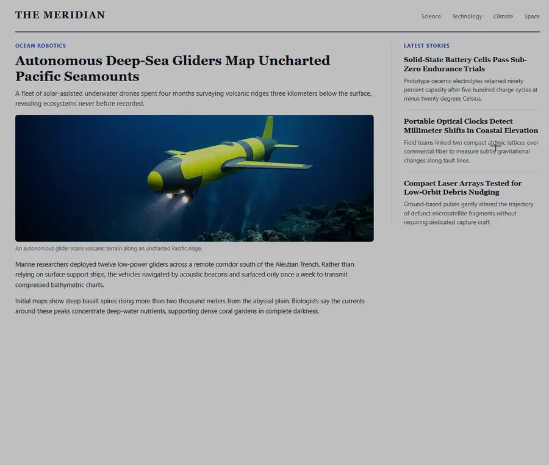
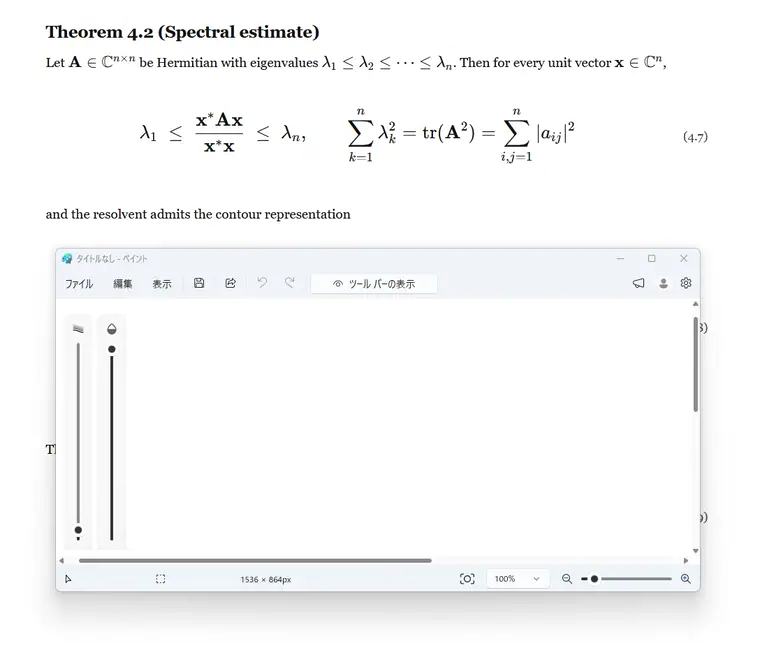
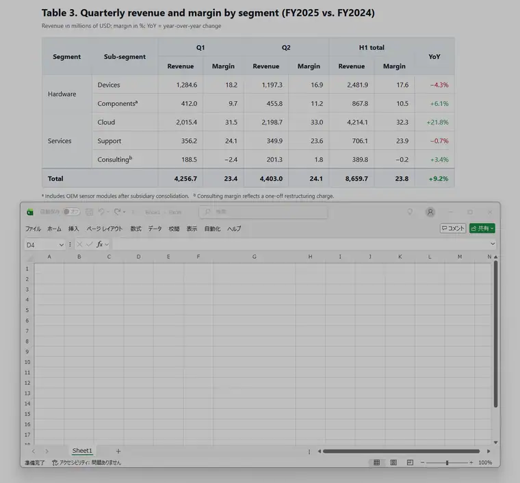

# スクショはローカルAIにぶん投げろ！ v1.4.3

**囲った範囲の画像を PC の AI（Ollama）に送り、答えをキャプチャ枠の中に透過表示する Windows 向けツールです。**



画像は、プリセットごとに設定した指示（プロンプト）と一緒に送ります。翻訳・OCR・数式・表の読み取りなどに使えます。内蔵 OCR（PP-OCRv6）で読み取った文字を送ることもでき、OCR だけなら Ollama なしでも使えます。  
答えはそのままクリップボードにコピーでき、枠の外に表示することもできます。  
ゲーム・PDF・動画・Web ページ・ほかのアプリなど、画面に映るものなら何でも対象にできます。

## できること

最初から4つのプリセットを用意しています。

- **翻訳**: 枠の中の文字を読み取り、日本語に翻訳します。
- **OCR**: 枠の中の文字を読み取り、テキストにします（Ollama 不要）。
- **数式**: 数式を読み取り、LaTeX や画像でコピーできます。
- **表**: 表を読み取り、Excel にそのまま貼れる形でコピーできます。

| 数式（LaTeX や画像でコピー） | 表（Excel にそのまま貼れる形でコピー） |
| :---: | :---: |
|  |  |

設定で、いろいろ自由に変えられます。

- 使う AI モデルや指示を変える・自分用のプリセットを作る
- 画面の区画を自動で検出し、枠の中では元の文字の位置に重ねて表示する（内蔵 OCR・VLM のどちらでも利用可能）
- 枠の中と外窓それぞれの背景色・文字色・不透明度を設定する
- 文字起こししてから AI に渡すか、画像のまま画像対応の AI（VLM）に渡すかを選ぶ
- 画面が止まったら自動で読み取る・答えを自動でコピーする・答えに続けて質問する・タスクトレイに常駐する など

## こんな時に

- 翻訳されていないゲームで、台詞が取り出せない場面や、壁・看板など絵の中の文字を読みたい
- 論文・教科書の数式や表を、LaTeX や表として取り出したい

## 導入手順

### 1. zip を展開して起動する

1. `Bunnagetaro-v1.4.3-win-x64.zip` を右クリックし、「すべて展開」で任意のフォルダへ展開します。
2. 展開した中の `Bunnagetaro` フォルダを開き、`Bunnagetaro.exe` を起動します。
   - `Bunnagetaro.exe` だけを別の場所へ移動すると動作しません（同じフォルダの DLL や `Models` フォルダが必要です）。デスクトップなどから起動したい場合はショートカットを作成してください。
   - 初回起動時に Windows SmartScreen の警告が出た場合は、「詳細情報」→「実行」を選択してください。

※ プリセット「OCR」（内蔵 OCR のみ）を使う場合は、下の 2〜3（Ollama の導入）は不要です。

### 2. Ollama をインストールする（翻訳・数式・表を使う場合）

1. [Ollama 公式サイト](https://ollama.com/download) から Windows 版をインストールします。
2. インストール後、Ollama を起動します（タスクトレイにアイコンが表示されていれば起動中です）。

### 3. モデルを取得する

スタートメニューで `cmd` と検索してコマンドプロンプトを開き、使いたいプリセットのモデルを取得します。

- **翻訳**（PLaMo 3 Translate）
  ```bat
  ollama pull hf.co/pfnet/plamo-3-translate-0.8b-GGUF:Q4_K_M
  ```
  - PLaMo 3 Translate には、より大きい 2B・8B・31B の版もあります。PC の性能（GPU のメモリ）に余裕があれば、大きい版の方が翻訳の質が上がることが多いです。使う時は、設定ページのプリセット欄でモデル名を変更してください。
- **数式**（GLM-OCR）
  ```bat
  ollama pull glm-ocr
  ```
- **表**（PaddleOCR-VL 1.6）
  ```bat
  ollama pull hf.co/PaddlePaddle/PaddleOCR-VL-1.6-GGUF
  ```

別の Ollama モデル（`gemma4`、`qwen3-vl` 等）を使う場合は、設定ページのプリセット欄でモデルと指示を変更してください。

### 4. 接続を確認して使う

1. 「設定」→「AI接続」で「接続テスト」「モデル一覧を取得」を押します。
2. 「キャプチャ窓を開く」を押し、読みたい範囲に枠を合わせてバーの「ぶん投げる」を押します。

## ソースからビルドする

- 必要な環境: Windows 10 / 11 (64bit)、[.NET 8 SDK](https://dotnet.microsoft.com/download/dotnet/8.0)

```bat
git clone https://github.com/gonsuke0926-hub/Bunnagetaro.git
cd Bunnagetaro
dotnet build Bunnagetaro5.sln
```

※ 初回ビルド時に内蔵 OCR モデル（PP-OCRv6）と区画検出モデル（PP-DocLayoutV3）を Hugging Face から自動取得し、SHA256 を検証して配置します。

配布用フォルダ（`publish`）を作成する場合:

```bat
dotnet publish Bunnagetaro5 -c Release -r win-x64 --self-contained true -p:PublishSingleFile=true -o publish
```

## 既定プリセット

| プリセット | 1 レイアウト判定 | 2 前処理 | 3 AI処理（想定モデル） | Ollama |
| :--- | :--- | :--- | :--- | :--- |
| 翻訳 | 使用する | 内蔵OCR（`PP-OCRv6 small`） | `hf.co/pfnet/plamo-3-translate-0.8b-GGUF:Q4_K_M` | 要 |
| OCR | 使用する | 内蔵OCR（`PP-OCRv6 small` / `medium` 同梱） | 使用しない | 不要 |
| 数式 | 使用しない | 使用しない（画像のまま渡す） | `glm-ocr` | 要 |
| 表 | 使用しない | 使用しない（画像のまま渡す） | `hf.co/PaddlePaddle/PaddleOCR-VL-1.6-GGUF` | 要 |

設定ページの「処理の流れ」で、プリセットごとに `1 レイアウト判定`（PP-DocLayoutV3）→ `2 前処理`（`内蔵OCR` / `VLM`）→ `3 AI処理` の各段を「使用する」かどうか選べます（前処理だけで AI に頼まず読んだ文をそのまま出す・画像のまま AI に渡す、なども可能）。  
数式・表は解答欄の右クリックからコピーできます。

## 動作環境

- OS: Windows 10 / 11 (64bit)
- Ollama: ローカルで起動していること（既定 URL: `http://localhost:11434`。内蔵 OCR のみ使う場合は不要）
- Microsoft Edge WebView2 Runtime: Windows 10 / 11 には通常標準搭載されています（数式・表の描画に使用）
- 動作の目安: 次の PC で、既定のプリセット（モデルを含む）が実用的に使える程度に動くことを確認しています（速くはありません）。専用の GPU がある PC では、より速く動きます。
  - CPU: Intel Core 5 320（6 コア）／メモリ: 16GB／GPU: CPU 内蔵（Intel Graphics）

## 設定・ログの場所とアンインストール

- 設定とログは `%APPDATA%\Bunnagetaro5` に保存されます。
- アンインストール時は、展開したフォルダと `%APPDATA%\Bunnagetaro5` を削除してください。

## ライセンス

- 本ソフトウェアは **MIT License**（[LICENSE](LICENSE)）の下で公開しています。個人・商用を問わず自由に利用・改変・再配布できます（無保証）。
- 同梱のサードパーティソフトウェア（PP-OCRv6 / PP-DocLayoutV3 / ONNX Runtime / DirectML / KaTeX 等）のライセンス表記は `THIRD_PARTY_NOTICES.txt`（およびアプリ内「バージョン情報」）をご確認ください。
- Ollama で別途取得する AI モデルは、各モデル配布元のライセンス条件に従ってください。
